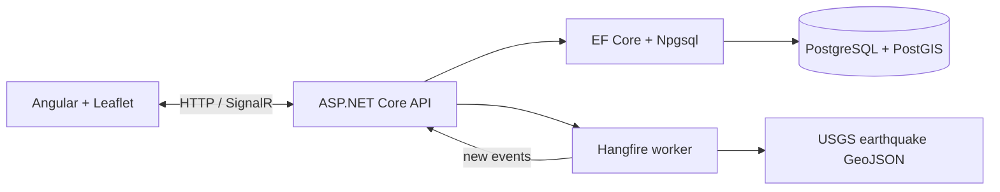

# Volcanic & Seismic Hazard Dashboard

A real-time portfolio project for monitoring recent USGS earthquakes around a static catalog of volcanoes. It demonstrates ASP.NET Core 10, EF Core/PostGIS spatial queries, Hangfire scheduled ingestion, SignalR push, and an Angular/Leaflet frontend.

The project is deliberately informed by my background in volcanology and geospatial analysis: DEM-based volcanic volume calculations, ArcGIS Pro, GDAL, GMT, and Python. The goal is to show how that domain experience can be combined with production-shaped full-stack engineering.

## Architecture



The Smithsonian Global Volcanism Program catalog is treated as a static seed dataset; there is no assumed live GVP API.

## Important scientific disclaimer

The hazard score is a heuristic, not a scientific forecast. It is a portfolio demonstration that combines event count, magnitude, recency, and depth. It must not be used for emergency decisions, eruption prediction, or real-world risk assessment.

## Run locally with Docker

Requirements: Docker Desktop with Compose support.

```bash
docker compose up --build
```

Open:

- Dashboard: [http://localhost:8080](http://localhost:8080)
- API health: [http://localhost:5001/health](http://localhost:5001/health)
- Hangfire dashboard: [http://localhost:5001/hangfire](http://localhost:5001/hangfire)

The Compose startup sequence waits for PostGIS to become healthy. The API applies the EF migration and seeds the static volcano catalog on first startup. Hangfire creates its own PostgreSQL storage tables and begins polling the public USGS all-day feed every ten minutes.

For Angular development outside Docker:

```bash
cd HazardDashboard.Web
npm install
npm start
```

The API allows the Angular dev origin `http://localhost:4200`, as well as the Docker web origins. The frontend currently calls the Docker API at `http://localhost:5001`.

## Screenshots / demo media


`docs/screenshots/dashboard-placeholder.png` — replace with a captured dashboard screenshot.


`docs/screenshots/live-updates-placeholder.gif` — replace with a short SignalR live-update recording.

## Portfolio walkthrough

1. Start the Compose stack and inspect the seeded volcano map.
2. Open Hangfire to show the recurring USGS ingestion job.
3. Select a volcano to show its spatially filtered contributing events and heuristic score.
4. Watch the browser receive `NewSeismicEvents` over SignalR without refetching the full dataset.
