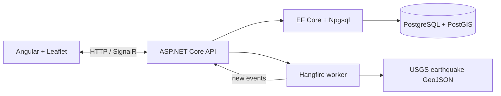

# Volcanotoria

### Volcanic and seismic monitoring with ASP.NET Core and Angular

A real-time portfolio project for monitoring recent USGS earthquakes around a static catalog of volcanoes. It demonstrates ASP.NET Core 10, EF Core/PostGIS spatial queries, Hangfire scheduled ingestion, SignalR push, and an Angular/Leaflet frontend.

The project is deliberately informed by my background in volcanology and geospatial analysis: DEM-based volcanic volume calculations, ArcGIS Pro, GDAL, GMT, and Python. The goal is to show how that domain experience can be combined with production-shaped full-stack engineering.

## Architecture



The application seeds a small static volcano catalog (currently 20 entries). It does not poll a live Smithsonian Global Volcanism Program API. Catalog provenance, eruption dates, and status classifications still need verification before this data could be treated as authoritative.

## Important scientific disclaimer

The hazard score is a heuristic, not a scientific forecast. It is a portfolio demonstration that combines event count, magnitude, recency, and depth. It must not be used for emergency decisions, eruption prediction, or real-world risk assessment.

## Run locally with Docker

Requirements: Docker Desktop with Compose support.

```bash
git clone git@github.com:Davitigs/Volcanotoria.git
cd Volcanotoria
docker compose up --build
```

Open:

- Dashboard: [http://localhost:8080](http://localhost:8080)
- API health: [http://localhost:5001/health](http://localhost:5001/health)
- Hangfire dashboard: [http://localhost:5001/hangfire](http://localhost:5001/hangfire)

The Compose startup sequence waits for PostGIS to become healthy. The API applies the EF migration and seeds the static volcano catalog on first startup. Hangfire creates its own PostgreSQL storage tables and begins polling the public USGS all-day feed every ten minutes.

Allow up to ten minutes for the first scheduled poll. A new database has no historical earthquakes: the 7-day and 30-day filters only show events already ingested, not an automatic historical backfill.

The Hangfire dashboard is development-only and retains Hangfire's default local-request authorization. Requests through Docker networking may receive HTTP 403. Do not disable authorization on a publicly deployed dashboard.

Host ports `8080` (web), `5001` (API), and `5433` (Postgres) must be available. Internal service ports are different; changing a host mapping does not change the container's listening port. Changing the API host port also requires updating the frontend API and SignalR URLs.

Stop the stack with `docker compose down`. The database volume is retained. The Compose credentials are local demo values, not production credentials; this stack is intended for local review, not public deployment.

For Angular development outside Docker:

```bash
cd HazardDashboard.Web
npm install
npm start
```

The API allows the Angular dev origin `http://localhost:4200`, as well as the Docker web origins. The frontend currently calls the Docker API at `http://localhost:5001`.

## Verify the application

With the stack running:

```bash
curl --fail http://localhost:5001/health
curl --fail http://localhost:5001/api/volcanoes
curl --fail 'http://localhost:5001/api/seismic-events/near?lat=37.75&lon=14.99&radiusKm=50'
docker compose logs --tail=100 api
```

`/health` confirms that the HTTP application responds; it is not a database or upstream-feed readiness check. The volcano endpoint should return the seeded catalog. The spatial query may legitimately return an empty array.

Frontend static checks (after installing dependencies):

```bash
cd HazardDashboard.Web
npm run lint
npm run typecheck
npm run format:check
npm run build
```

Automated unit/integration coverage and a working frontend test target are still outstanding; static checks are not a substitute for tests. Screenshots and a recorded demo will be added once captured from the running application.

## Current scope and next steps

- Spatial proximity uses PostGIS geography columns in SRID 4326; distances are in meters.
- New earthquake records are pushed over SignalR. Existing-record updates are persisted but are not pushed as new events.
- The score is computed on demand within 50 km over the preceding 30 days. Its current sum can saturate quickly and needs calibration and regression tests; it is not a validated scientific model.
- UI work remains: route-scoped state/facades, request cancellation, reconnect recovery, and a contributing-event detail list. See the [Angular audit](HazardDashboard.Web/ANGULAR_AUDIT.md).
- Before production use: authentication, protected operational endpoints, configurable frontend URLs, readiness checks, resilient ingestion, and deployment hardening.

## Code navigation

- [API startup](HazardDashboard.Api/Program.cs): service registration, database initialization, recurring job, and routes.
- [Database model](HazardDashboard.Api/Data/HazardDbContext.cs): EF mapping and spatial indexes.
- [USGS ingestion](HazardDashboard.Api/Jobs/UsGeologicalSurveyIngestionJob.cs): deliberate GeoJSON mapping and persistence.
- [Hazard controller](HazardDashboard.Api/Controllers/VolcanoesController.cs): query validation and spatial scoring.
- [Angular feature](HazardDashboard.Web/src/app/features/hazard): feature, UI, and data-access boundaries.
- [Learning tour](LEARNING_TOUR.md): implementation notes and comparisons with NestJS/Prisma; earlier entries include historical decisions later corrected.

## Portfolio walkthrough

1. Start the Compose stack and inspect the seeded volcano map.
2. Inspect API logs for the recurring USGS ingestion job (or Hangfire when accessible locally).
3. Select a volcano to show its detail, heuristic score, and contributing-event count; the API returns contributing event IDs.
4. Watch the browser receive `NewSeismicEvents` over SignalR without refetching the full dataset.
